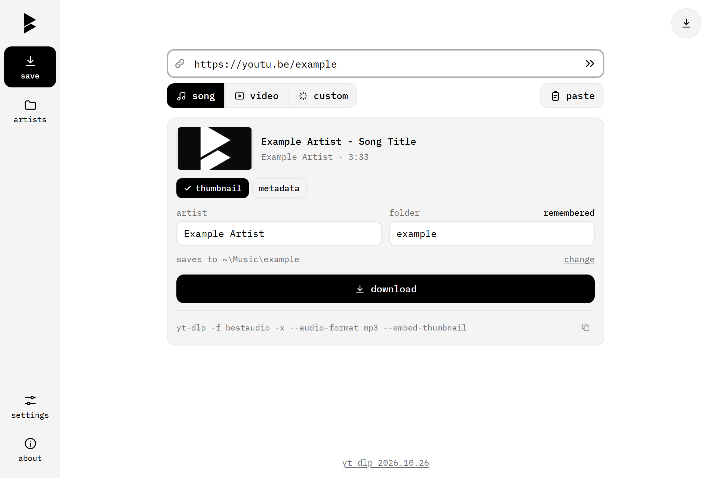
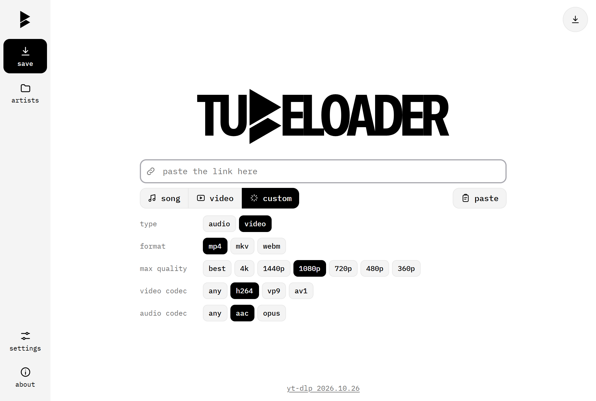
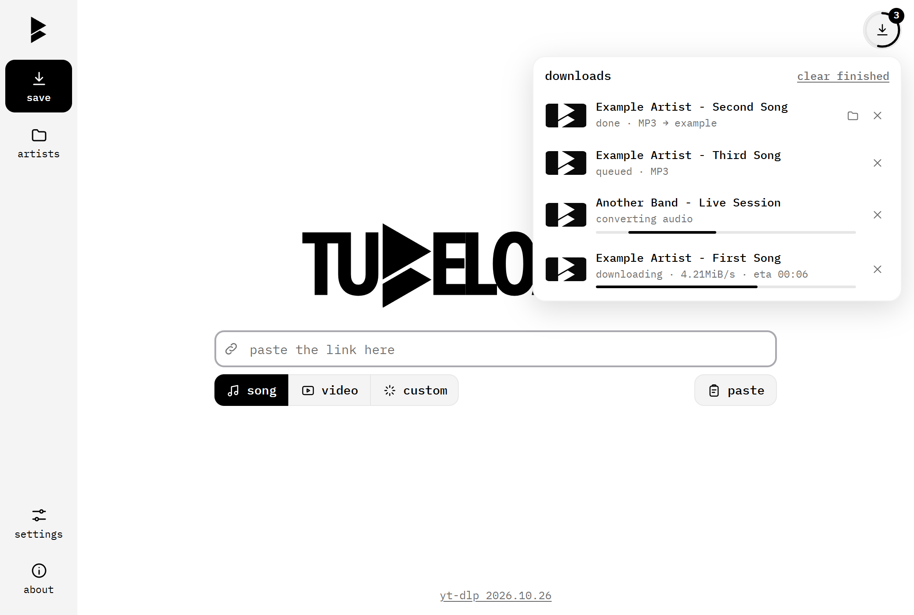

<h1 align="center">
  <picture>
    <source media="(prefers-color-scheme: dark)" srcset="assets/logo-white.svg">
    
  </picture>
</h1>

  A small, fast YouTube downloader for Windows. 
  Paste a link, pick a mode, done. Nothing to install.

  <a href="https://github.com/BuiltByWestL/Tube-Loader/releases/latest/download/TubeLoader.exe">
    <picture>
      <source media="(prefers-color-scheme: dark)" srcset="https://img.shields.io/badge/Download-TubeLoader.exe-ffffff?style=for-the-badge&logo=windows&logoColor=black&labelColor=ffffff">
      
    </picture>
  </a>

  Windows 10 / 11 · 24 MB · <a href="https://github.com/BuiltByWestL/Tube-Loader/releases">all releases</a>

  <picture>
    <source media="(prefers-color-scheme: dark)" srcset="assets/screenshots/song-dark.png">
    
  </picture>

## Features

- **One file, no setup.** No Python, no yt-dlp, no ffmpeg to install. Tube Loader fetches what it needs on first launch and skips anything you already have.
- **Always up to date.** Checks for a new yt-dlp every launch, so downloads keep working when YouTube changes.
- **Songs sort themselves.** MP3s with cover art land in a folder named after the artist. If the folder exists, it's reused.
- **Your folder names stick.** Tell it once that Ax and the Hatchetmen go in `aath`, and every future download goes there.
- **Full control when you want it.** Pick the format, resolution and codecs, and see the exact yt-dlp command being run.
- **Playlists and a queue.** Paste a playlist and each song is sorted on its own. Cancel, retry and keep going.
- **Private.** Everything runs on your computer. No accounts, no tracking, no server in the middle.

<table>
  <tr>
    <td width="50%">
      <picture>
        <source media="(prefers-color-scheme: dark)" srcset="assets/screenshots/custom-dark.png">
        
      </picture>
    </td>
    <td width="50%">
      <picture>
        <source media="(prefers-color-scheme: dark)" srcset="assets/screenshots/queue-dark.png">
        
      </picture>
    </td>
  </tr>
</table>

## Getting started

1. [Download `TubeLoader.exe`](https://github.com/BuiltByWestL/Tube-Loader/releases/latest/download/TubeLoader.exe) and put it anywhere.
2. Double-click it. The first launch takes a moment while it sets up.
3. Paste a link. Ctrl+V works anywhere in the window, then Enter starts the download.

Music saves to your Music folder and videos to your Videos folder. You can change both in settings.

> **Windows may warn you the first time.** The exe isn't code-signed, so SmartScreen can show "Windows protected your PC". Click **More info**, then **Run anyway**. If you'd rather not, you can read the source and build it yourself.

## Modes

| Mode | What you get | yt-dlp arguments |
|---|---|---|
| **Song** | MP3 with cover art, in an artist folder | `-f bestaudio -x --audio-format mp3 --embed-thumbnail` |
| **Video** | Best quality MP4 | `-S res,ext:mp4:m4a --recode-video mp4` |
| **Custom** | Audio: mp3, m4a, opus, ogg, flac, wav, aac or original. Video: mp4, mkv or webm, with resolution and codec choices | Built from your choices and shown in the app |

Thumbnail and metadata are switches on every mode. Combinations that can't work, such as cover art in a webm, are turned off for you.

## Artist folders

Songs go to `<Music folder>\<Artist>\`.

1. The artist comes from the video's metadata, then an "Artist - Title" title, then the channel name. You can edit it before downloading.
2. If a folder for that artist already exists, in any capitalisation, it's reused. Otherwise it's created.
3. To send an artist somewhere specific, change the **folder** box and leave **remember** on. Manage the list on the **artists** tab.

## What it installs

Tools go in `%LOCALAPPDATA%\TubeLoader\bin`, and only if they're missing:

| Tool | Already on your PC | Otherwise |
|---|---|---|
| yt-dlp | Used as it is, and updated with `yt-dlp -U` | Downloaded from GitHub, checked against the release's SHA-256 sums |
| ffmpeg and ffprobe | Used as they are | Downloaded once (about 330 MB unpacked) |
| JavaScript runtime, which YouTube needs | Deno or Node used as it is | Deno downloaded |

Settings and remembered artists live in `%LOCALAPPDATA%\TubeLoader\data`.

The window is drawn by WebView2, which comes with Windows 11 and most Windows 10 PCs. The Edge browser and its accounts aren't involved. If WebView2 is missing, Tube Loader opens in your default browser.

## Build from source

Run `build.bat` to create `dist\TubeLoader.exe`. It needs Python 3.9+ on the build machine only.

To run without building: `pip install pywebview`, then `python TubeLoader.pyw`.

The app itself uses only the Python standard library plus pywebview. The server listens on `127.0.0.1` only, rejects unexpected `Host` headers and requires a random per-launch token, so other websites can't drive it.

## Credits

Built on [yt-dlp](https://github.com/yt-dlp/yt-dlp) and [FFmpeg](https://ffmpeg.org). Set in [IBM Plex Mono](https://github.com/IBM/plex) ([SIL Open Font License](ui/fonts/OFL.txt)). Look inspired by [cobalt](https://cobalt.tools).

Please only download content you have the right to save.
