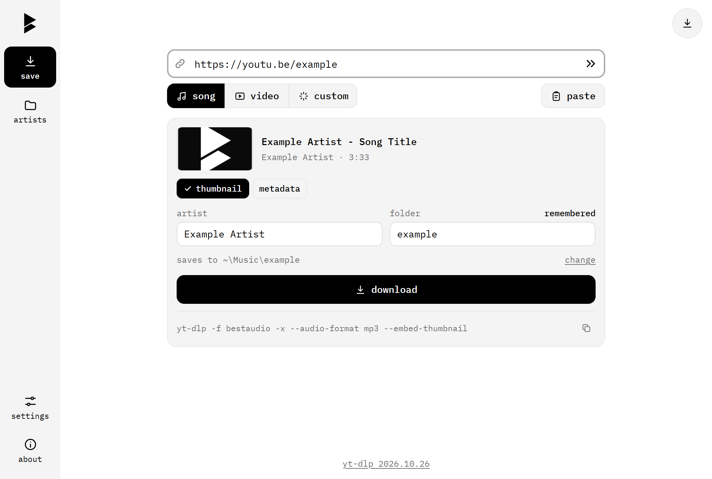
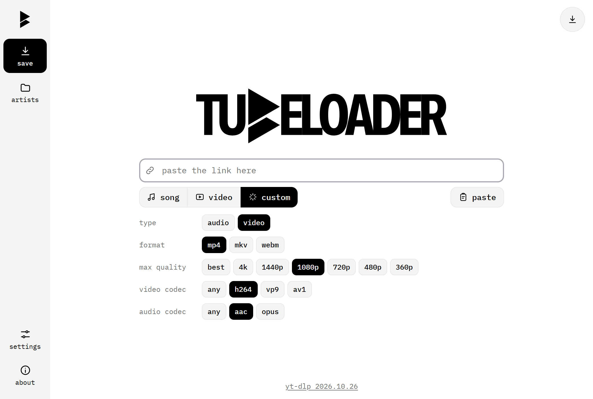
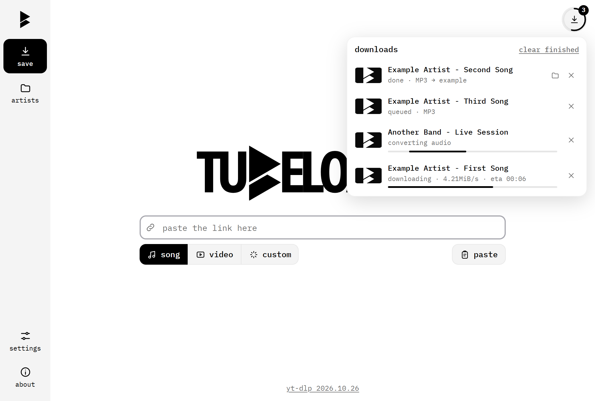

<h1 align="center">
  <picture>
    <source media="(prefers-color-scheme: dark)" srcset="assets/logo-white.svg">
    
  </picture>
</h1>

  A small, fast YouTube downloader for Windows and Mac. 
  Paste a link, clickd download, done. Nothing to install.

  <a href="https://github.com/BuiltByWestL/Tube-Loader/releases/latest/download/TubeLoader.exe">
    <picture>
      <source media="(prefers-color-scheme: dark)" srcset="https://img.shields.io/badge/Download-TubeLoader.exe-ffffff?style=for-the-badge&logo=windows&logoColor=black&labelColor=ffffff">
      
    </picture>
  </a>
  &nbsp;
  <a href="https://github.com/BuiltByWestL/Tube-Loader/releases/latest/download/TubeLoader-mac.dmg">
    <picture>
      <source media="(prefers-color-scheme: dark)" srcset="https://img.shields.io/badge/Download-for_Mac-ffffff?style=for-the-badge&logo=apple&logoColor=black&labelColor=ffffff">
      
    </picture>
  </a>

  Windows 10 / 11 · 24 MB &nbsp;|&nbsp; macOS, Apple Silicon and Intel · 26 MB · <a href="https://github.com/BuiltByWestL/Tube-Loader/releases">all releases</a>

  <picture>
    <source media="(prefers-color-scheme: dark)" srcset="assets/screenshots/song-dark.png">
    
  </picture>

## Features

- **One file.** No prereqs to install. Tube Loader fetches what it needs and skips anything you already have.
- **Always up to date.** Checks for a new yt-dlp and Tube Loader every launch, so downloads keep working when YouTube changes. Updates in-app.
- **Songs sort themselves.** MP3s with cover art land in a folder named after the artist. If the folder exists, it's reused.
- **Your folder names stick.** Tell it once that Tame Impala goes in `ti`, and every future download goes there.
- **Full control when you want it.** Pick the format, resolution and codecs, and see the exact yt-dlp command being run.
- **Playlists and a queue.** Paste a playlist and each song is sorted on its own. Cancel, retry and keep going.
- **Private.** Everything runs locally on your computer.
- **Useful anywhere.** Over 1,700 supported sites, listed at https://github.com/yt-dlp/yt-dlp/blob/master/supportedsites.md

<table>
  <tr>
    <td width="50%">
      <picture>
        <source media="(prefers-color-scheme: dark)" srcset="assets/screenshots/custom-dark.png">
        
      </picture>
    </td>
    <td width="50%">
      <picture>
        <source media="(prefers-color-scheme: dark)" srcset="assets/screenshots/queue-dark.png">
        
      </picture>
    </td>
  </tr>
</table>

## Getting started

### Windows

1. [Download `TubeLoader.exe`](https://github.com/BuiltByWestL/Tube-Loader/releases/latest/download/TubeLoader.exe) and put it anywhere.
2. Double-click it. The first launch takes a moment while it sets up.
3. Paste a link. Ctrl+V works anywhere in the window, then Enter starts the download.

Music saves to your Music folder and videos to your Videos folder. You can change both in settings.

> **Windows may warn you the first time.** The exe isn't code-signed, so SmartScreen can show "Windows protected your PC". Click **More info**, then **Run anyway**. If you'd rather not, you can read the source and build it yourself.

### Mac

1. [Download `TubeLoader-mac.dmg`](https://github.com/BuiltByWestL/Tube-Loader/releases/latest/download/TubeLoader-mac.dmg), open it and drag **Tube Loader** into **Applications**. One download works on both Apple Silicon and Intel Macs.
2. Open it from Applications. The first launch takes a moment while it sets up.
3. Paste a link. ⌘V works anywhere in the window, then Return starts the download.

Music saves to your Music folder and videos to your Movies folder. You can change both in settings.

> **macOS will block it the first time.** The app isn't notarized by Apple, so macOS says it "could not verify Tube Loader is free of malware". Click **Done**, open **System Settings → Privacy & Security**, scroll down and click **Open Anyway** next to Tube Loader, then confirm. You only need to do this once. On macOS 14 and earlier you can instead right-click the app, choose **Open**, then **Open** again.

### Updates

Tube Loader checks for a new version when it starts and offers to update. Updating downloads the new version, checks it against the release's SHA-256, swaps it in and restarts. Turn the check off in **settings → updates**.

The old version isn't deleted. It's renamed, for example to `TubeLoader 1.2.1.exe` or `Tube Loader 1.2.1.app`, and the new version asks whether to move it to the Recycle Bin or Trash, or keep it. It asks the same if you download a newer copy yourself and run it from somewhere else.

If Tube Loader can't replace itself, for example because it's in a folder that needs admin rights, it saves the new version to Downloads instead.

## Modes

| Mode | What you get | yt-dlp arguments |
|---|---|---|
| **Song** | MP3 with cover art, in an artist folder | `-f bestaudio -x --audio-format mp3 --embed-thumbnail` |
| **Video** | Best quality MP4 | `-S res,ext:mp4:m4a --recode-video mp4` |
| **Custom** | Audio: mp3, m4a, opus, ogg, flac, wav, aac or original. Video: mp4, mkv or webm, with resolution and codec choices | Built from your choices and shown in the app |

Thumbnail and metadata are switches on every mode. Combinations that can't work, such as cover art in a webm, are turned off for you.

## Artist folders

Songs go to `<Music folder>/<Artist>/`.

1. The artist comes from the video's metadata, then an "Artist - Title" title, then the channel name. You can edit it before downloading.
2. If a folder for that artist already exists, in any capitalisation, it's reused. Otherwise it's created.
3. To send an artist somewhere specific, change the **folder** box and leave **remember** on. Manage the list on the **artists** tab.

## What it installs

Tools go in `%LOCALAPPDATA%\TubeLoader\bin` on Windows and `~/Library/Application Support/TubeLoader/bin` on a Mac, and only if they're missing:

| Tool | Already on your PC | Otherwise |
|---|---|---|
| yt-dlp | Used as it is, and updated with `yt-dlp -U` | Downloaded from GitHub, checked against the release's SHA-256 sums |
| ffmpeg and ffprobe | Used as they are, including Homebrew's on a Mac | Downloaded once. Windows: about 330 MB unpacked. Mac: [Martin Riedl's static builds](https://ffmpeg.martin-riedl.de), checked against their SHA-256 sums |
| JavaScript runtime, which YouTube needs | Deno or Node used as it is | Deno downloaded |

Settings and remembered artists live in the `data` folder next to `bin`.

On Windows the window is drawn by WebView2, which comes with Windows 11 and most Windows 10 PCs. The Edge browser and its accounts aren't involved. If WebView2 is missing, Tube Loader opens in your default browser. On a Mac it uses the system's own WebKit, so there's nothing extra to install.

On a Mac, closing the window quits the app. If downloads are still running it asks first, and quitting stops them.

## Build from source

On Windows, run `build.bat` to create `dist\TubeLoader.exe`. On a Mac, run `sh build_mac.sh` to create `dist/Tube Loader.app` and `dist/TubeLoader-mac.dmg`. Use Python from the [python.org installer](https://www.python.org/downloads/macos/) to get one app for both Apple Silicon and Intel. Either way, Python 3.9+ is only needed on the build machine.

To run without building: `pip install pywebview`, then `python TubeLoader.pyw`.

The app itself uses only the Python standard library plus pywebview. The server listens on `127.0.0.1` only, rejects unexpected `Host` headers and requires a random per-launch token, so other websites can't drive it.

## Credits

Built on [yt-dlp](https://github.com/yt-dlp/yt-dlp) and [FFmpeg](https://ffmpeg.org). Set in [IBM Plex Mono](https://github.com/IBM/plex) ([SIL Open Font License](ui/fonts/OFL.txt)). Look inspired by [cobalt](https://cobalt.tools).

Please only download content you have the right to save.

## License

[MIT](LICENSE). IBM Plex Mono is under the [SIL Open Font License](ui/fonts/OFL.txt), and yt-dlp, ffmpeg and Deno keep their own licenses.
